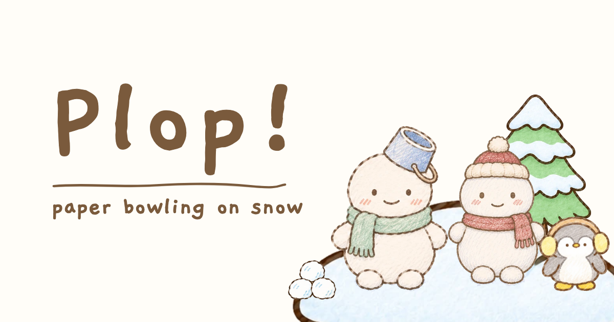
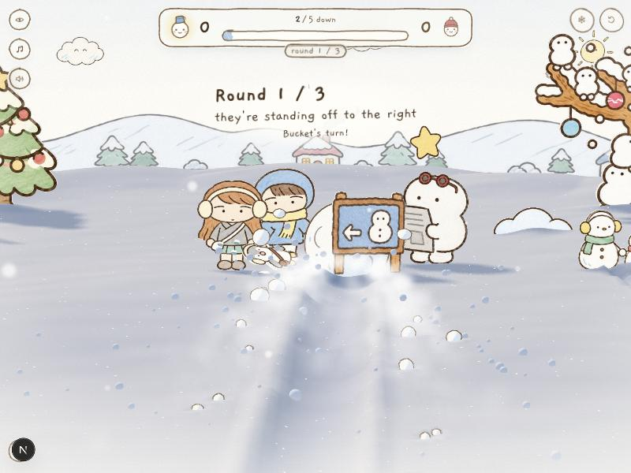
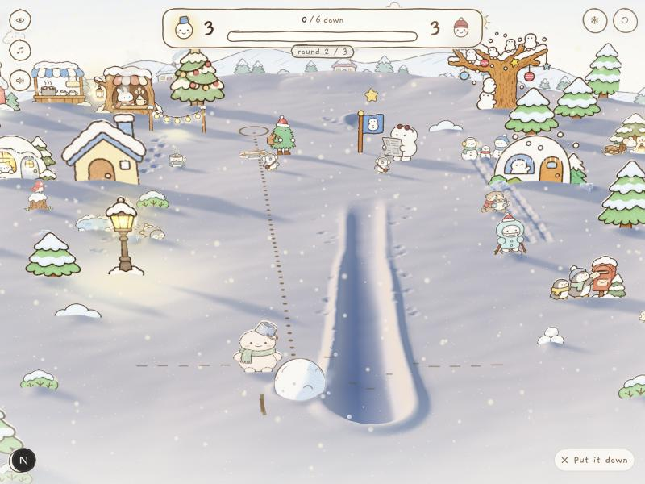
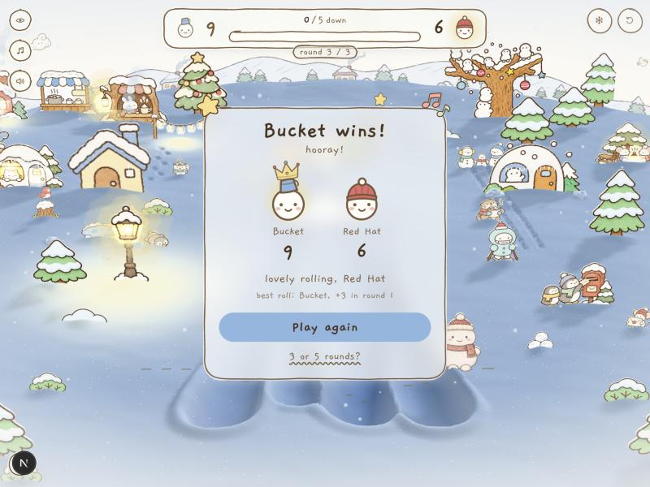
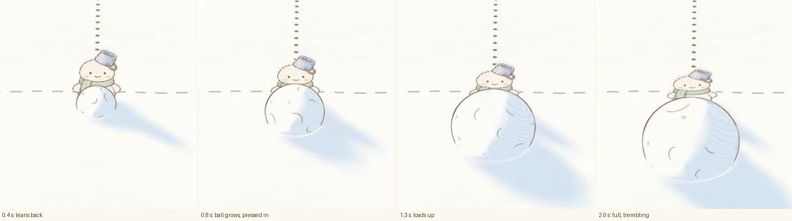
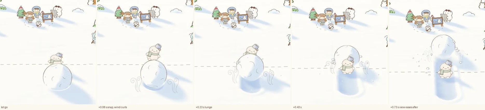
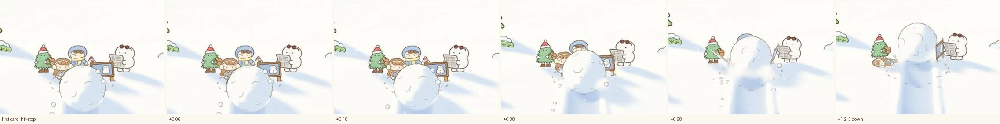
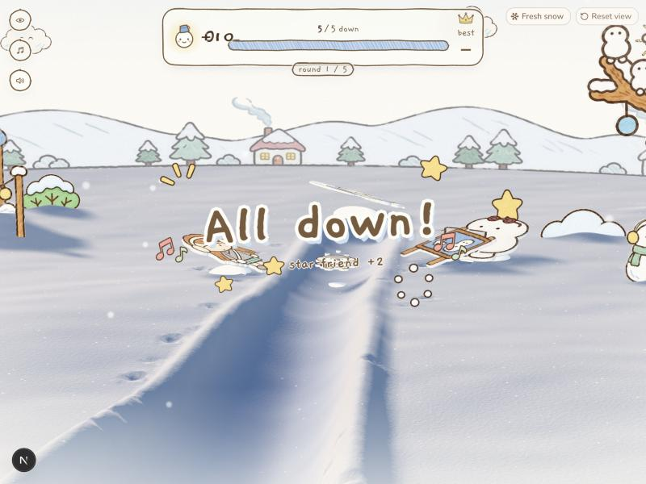
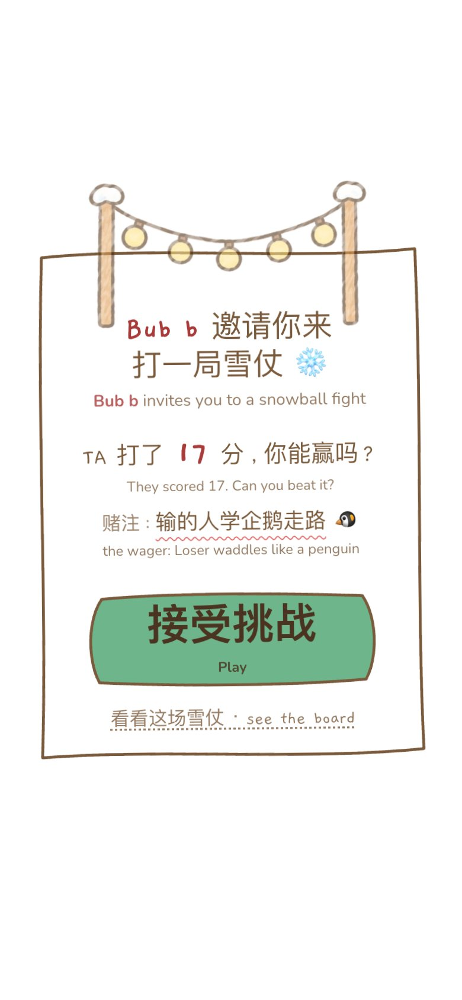
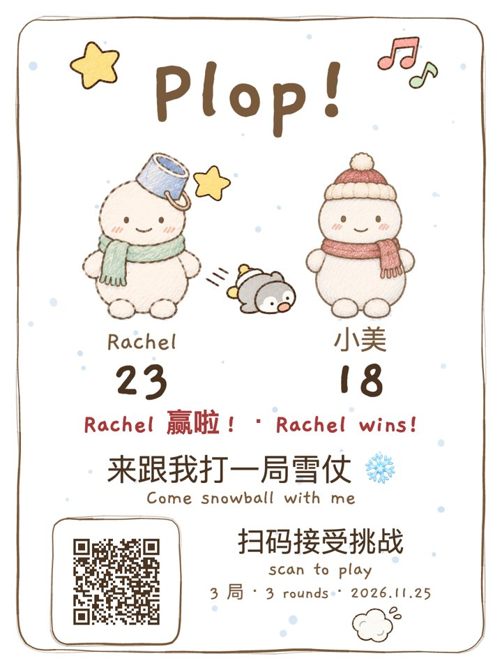

<div align="center">



# ❄️ Plop! ❄️

**A cute, calm stress-relief toy: paper bowling on snow.**
Pull back, roll a snowball bigger, let go, and watch a little crowd of paper friends tumble.

[**▶ Play it now**](https://plop-two.vercel.app) &nbsp;·&nbsp; [Why it exists](#why-it-exists) &nbsp;·&nbsp; [Modes](#modes-and-variations) &nbsp;·&nbsp; [How to play](#how-to-play) &nbsp;·&nbsp; [Friends & boards](#friends-boards-and-wagers) &nbsp;·&nbsp; [Run it yourself](#run-it-yourself)


</div>

A snowman in a cosy village made entirely of Rachel's hand-drawn paper cut-outs. Press on the snowman and drag back,
and the snowball at its feet rolls and grows. Let go, and it rolls through the crowd and knocks them over. Plop!

## Why it exists

Three small ideas became one game.

- **Real snow, paper people.** The look started from a contrast: soft, wet, real snow against flat cardboard
  cut-out characters. Everything that stands up is a paper card; everything you touch (the snowball, the groove it
  leaves, the falling flakes) behaves like snow. That is why the cut-outs flop instead of tumbling like toys.
- **Boston is cold and there is always too much snow, and never the right time for a snowball fight.** The
  snow is on the ground, but it is too icy, too cold, or you are on your way to class. Plop! is the snowball fight
  you can have from a warm room, in a minute, without getting wet.
- **The Christmas game that travels through WeChat.** Every December a silly little game goes around the group
  chats and everyone sends their score to see who did better. Plop! is built for that moment: no sign-up, one tap to
  send a challenge (a link, or a poster for Moments), and a group board so a chat becomes a small league.

## Modes and variations

| | What changes |
|---|---|
| **Match length** | 3 rounds (a few minutes) or 5 rounds. |
| **Who plays** | **Turns** (two friends alternate), **Together** (both snowmen on the line at once, aiming at the same crowd) or **Just me** (one throw a round, against your own best). |
| **Round rules** | Every round is the same bowling-pin crowd of paper friends with one small twist: *Strike!* (just bowl), *Hit the star* (+2), *Let the bunny be* (+2 if it stays standing), *Little mound* (a soft snow mound slows a straight ball), *Sleepy cat* (don't wake it). |
| **Light** | Afternoon in round 1, sunset in the middle, a lamp-lit evening by the last round. |
| **Challenges** | A wager on the end card (the loser waddles like a penguin), and a group board that ranks everyone who opens the same invite. |

Fresh snow (**N**) smooths the lane between throws, so no two matches leave the same grooves.

## A look inside

<table>
<tr>
<td align="center" width="33%"><br><sub><b>Round 1</b> · soft afternoon light</sub></td>
<td align="center" width="33%"><br><sub><b>Round 2</b> · the groove you rolled stays</sub></td>
<td align="center" width="33%"><br><sub><b>Round 3</b> · lamp-lit evening, a kind end card</sub></td>
</tr>
</table>

## The throw: pull, roll, plop

**1 · Pull back.** The snowball at the snowman's feet grows the longer you hold, and starts to tremble when it is full.



**2 · Let go.** A snap, little wind curls, and the snowball lunges away down the lane, leaving a groove in the snow.



**3 · Plop!** The ball hits the paper friends, the game freezes for a blink, then everyone topples.



<p align="center"><br><sub>All down! A full clear, plus a bonus for hitting the star friend.</sub></p>

## What it is

- **A short match** of 3 or 5 rounds: two friends take turns (Bucket and Red Hat), roll **together** at the same
  time, or play **just me**. Each round brings a new set of cut-outs that asks a different shot, and the light moves
  from afternoon to a cosy lamp-lit evening by the last round.
- **Scoring:** one point per card down, a bonus for a full clear, +2 for the star friend, +2 for leaving the bunny
  standing. The end card is kind, never "you lose".
- **Made to send to a friend:** one tap on the end card sends an invite link with your score and, if you like, a
  silly wager (loser waddles like a penguin). Everyone who opens the same invite shares a **group board**: a ranked
  list with #1 on a snow mound in sunglasses, funny titles, friend stickers and an opt-in "today's oops".
- **No sign-up.** You type a nickname once; that is all it knows about you.

## How to play

| | Move along the line | Pull back and aim | Throw |
|---|---|---|---|
| **Mouse / trackpad** | drag the snowman left or right | press on the snowman and drag back; sideways sets the angle | let go |
| **Touch** | same as mouse | same as mouse | let go |
| **Keyboard** | A / D or ← / → | hold Space (the pull grows while held); A / D or ← / → aim | release Space |

- **Together mode:** Bucket uses A / D and holds W (or Space); Red Hat uses ← / → and holds ↑ (or Enter). On a
  phone or trackpad, each player drags their own snowman.
- **The sweet spot:** two small pencil ticks beside the ball mark it; pulling past it makes the ball heavy and the aim sway.
- **Escape** or the "Put it down" button cancels a pull (it does not count as a throw).
- **Look around:** drag on empty snow to turn and tilt, scroll or pinch to rise and pull back. "Reset view" returns
  to the throwing view.
- **Fresh snow** (button or **N**): new snow falls and smooths every groove away.
- The corner buttons switch the music and the sound effects on and off. Sound (music, the quiet village ambience
  and the little cue sounds) starts after the first tap, as browsers require.

## Friends, boards and wagers

| Part | What it does | Where it lives |
|---|---|---|
| **Invite** | `/invite?g=…&from=…&score=…`: a white welcome card, "X invites you", their score, the group's board and one big Play button. Only a group id, a short name, a whole-number score and a wager code travel in the link. | [`src/features/invite`](src/features/invite) |
| **Group board** | A scoreboard per invite group, no login. Ranked list, #1 on a podium, plain-language titles, an overtake notice ("X just passed you"), snowball hits and friend stickers. | [`src/features/leaderboard`](src/features/leaderboard) |
| **Wagers** | Pick "no bet" or one of six kind, silly lines. The end card shows the loser with the wager's emoji dropping onto their head. | [`src/features/share`](src/features/share) |
| **Poster** | "Make a poster": a 1080 × 1440 PNG drawn in the browser with a QR code, for WeChat Moments, which cannot post links. | [`src/features/poster`](src/features/poster) |
| **Scores database** | Supabase (Postgres), server side only, row-level security on. Without keys the board runs in demo mode. | [`supabase/`](supabase/README.md) |

<table>
<tr>
<td align="center" width="50%"><br><sub><b>The invite</b> a friend opens from a chat</sub></td>
<td align="center" width="50%"><br><sub><b>The poster</b> for WeChat Moments, QR included</sub></td>
</tr>
</table>

## Sharing in WeChat

The round paper-plane button at the bottom left shares the game: the system share sheet where the browser has one,
"link copied!" where it does not, and inside WeChat a little note pointing to the top-right **···** menu (WeChat does
not let a page open its share menu by itself).

**What works today (no account, no setup):**

- The link opens and plays inside WeChat's own browser on iPhone and Android: the 3D snow, dragging the snowman,
  sound after the first tap (iPhones only make sound after a tap anyway), and vibration on Android (iPhones have none).
- Sending the link from WeChat's ··· menu. The chat card uses what WeChat can read without an Official Account: the
  title "Plop!", the description, and a square picture of the snowmen (the first image on the page). WeChat versions
  differ: some show this picture and text, some show only the title and a plain link icon. That is WeChat's choice.
- Other apps (iMessage, Slack, X, Discord, Telegram…) show the full share card with the art.

**What a full rich WeChat card would need** (title, text and picture you choose, every time):

1. A domain of our own (`*.vercel.app` addresses are often slow or blocked in mainland China, and WeChat may warn
   before opening them).
2. ICP filing (备案) for that domain, which in practice means hosting it in mainland China, not only on Vercel.
3. A verified WeChat Official Account (认证公众号), with the domain added as its JS-SDK safe domain (JS接口安全域名).
4. A small server endpoint that signs the JS-SDK config with the account's secret, then `wx.updateAppMessageShareData`
   on the page. That adds a key to keep secret and code that runs on a server.

None of this was tested inside WeChat itself (it cannot be run here); it follows WeChat's known webview rules.

## Add to home screen

Plop can sit on a phone's home screen like an app and open full-screen, with the bucket-hat snowman as its icon.

- **iPhone (Safari):** tap the Share button, then **Add to Home Screen**.
- **Android (Chrome):** tap the **⋮** menu, then **Add to Home screen** (or **Install app**).
- Inside WeChat this is not offered: open the link in the phone's browser first (··· → Open in Browser).

There is no offline mode yet: the game still needs the internet each time it opens (no service worker, nothing
cached on purpose). The icons are the existing snowman cut-out on paper (`public/icons/`), not new art.

## Privacy

Plop keeps as little as it can.

- **Group boards store:** a nickname you type, the group id from the invite link, your match scores and a few
  play-style counters (full clears, throws, and so on), plus stickers friends send. No accounts, no email, no
  passwords. The table is closed to everyone except the game's own server.
- **Today's oops is opt-in:** only if you tick the box does your lowest throw of the day go on the board.
- **Vercel Web Analytics and Speed Insights**, no cookies and nothing saved on your phone. Vercel tells visitors
  apart with a hash that resets every day.
- **Invite links are counted without their extra parts:** `/invite?from=…&score=…` is counted only as `/invite`, so
  the nickname, group and score in it are never sent to analytics.
- **What analytics count:** pages opened, the referrer, country, browser and device type, page speed, and a few game
  moments (a match starts or ends, an invite is made or opened, the share button is tapped, a poster is made).
- Only members of the Vercel project can see the numbers. To remove a rude name, see [`supabase/README.md`](supabase/README.md).

## Test pages (`/dev/*`)

Small pages for checking one part at a time. Not linked from the game and hidden from search engines.

| Page | What it shows |
|---|---|
| [`/dev/bowling`](https://plop-two.vercel.app/dev/bowling) | The throw alone on the snow: pull, aim line, roll (add `?fps` for the frame rate). |
| [`/dev/pins`](https://plop-two.vercel.app/dev/pins) | The paper cut-out pins with physics, chain reactions and the "N down!" count. |
| [`/dev/village`](https://plop-two.vercel.app/dev/village) | The whole scene without the score: throwing view, the village on the snow, the throw. |
| [`/dev/scenery`](https://plop-two.vercel.app/dev/scenery) | Every scenery cut-out on a sheet, plus the layout and camera previews. |
| [`/dev/scenery-3d`](https://plop-two.vercel.app/dev/scenery-3d) | Thick paper standees in 3D (`?view=default\|side\|high`, `?look=full\|flat\|billboard\|fixed`). |
| [`/dev/snowfall`](https://plop-two.vercel.app/dev/snowfall) | Press and mess up the snow, then try "Fresh snow". |
| [`/dev/hud`](https://plop-two.vercel.app/dev/hud) | The floating score panel and the music / sound switches with test buttons. |
| [`/dev/look`](https://plop-two.vercel.app/dev/look) | The real game with the paper finish (grain, soft edge) and before / after switches. |
| [`/dev/audio`](https://plop-two.vercel.app/dev/audio) | Every sound effect with a play button. |
| [`/dev/time`](https://plop-two.vercel.app/dev/time) | The village from afternoon to evening with a time-of-day slider (`?t=0.5`, `?play`). |
| [`/dev/sky`](https://plop-two.vercel.app/dev/sky) | The paper sky and far hills through the day, with a slider. |
| [`/dev/music`](https://plop-two.vercel.app/dev/music) | The background music player. |
| [`/dev/leaderboard`](https://plop-two.vercel.app/dev/leaderboard) | The group board with fake groups of 2, 5 and 10, and buttons that make someone overtake someone. |
| [`/dev/wager`](https://plop-two.vercel.app/dev/wager) | The wager picker and the end-card wager effect. |
| [`/dev/tokens`](https://plop-two.vercel.app/dev/tokens) | The design tokens: colours, fonts and corner radius. |

## Where things are

| Folder / file | What is in it |
|---|---|
| [`docs/SPEC.md`](docs/SPEC.md) | What Plop! is and why it looks the way it does. |
| [`docs/GAMEPLAY.md`](docs/GAMEPLAY.md) | How the game plays: the loop, the controls, scoring (source of truth for interaction). |
| [`docs/DECISIONS.md`](docs/DECISIONS.md) | Every decision so far, dated, so later work does not undo it. |
| [`docs/TUNING.md`](docs/TUNING.md) | The ten feel numbers that matter most and where they live. |
| [`docs/BLUEPRINT.md`](docs/BLUEPRINT.md) | The build map: what is done, what runs now, what waits. |
| [`docs/REVIEW.md`](docs/REVIEW.md) | A designer review of the whole game against the art. |
| [`docs/CREDITS.md`](docs/CREDITS.md) | Music and anything else made by other people, with licences. |
| `docs/reference/`, `art-source/` | Rachel's reference art: snowman turnarounds, scenery sheets, doodles. |
| `src/features/<name>/` | One folder per part of the game, each with its own README and `content.ts` of feel numbers. |
| `public/assets/` | The cut-out images and sounds, per feature. |
| [`CLAUDE.md`](CLAUDE.md) | Rules for coding sessions (look comes first, tokens only, one feature per folder). |

## Run it yourself

```bash
npm ci
npm run dev        # http://localhost:3000
npm run lint
npm run typecheck
npm run build
node scripts/smoke.mjs   # builds if needed, starts the server, checks every page loads
```

Copy `.env.example` to `.env.local` only if you want a real group board (the two Supabase keys; see
[`supabase/README.md`](supabase/README.md)). Without it everything works and the board runs in demo mode.

Built with Next.js, Tailwind, shadcn/ui and Three.js (React Three Fiber, drei, Rapier) and Supabase. Deployed on Vercel from
`main`; every pull request gets a preview link and runs CI (lint, typecheck, build, and the page smoke test).

## Credits

- **Art:** every character, prop and the village are Rachel's hand-drawn doodles and sheets (`art-source/`,
  `docs/reference/`), cut out into `public/assets/`.
- **Music and sounds:** see [`docs/CREDITS.md`](docs/CREDITS.md) for each file, its source and licence.
- **Fonts:** Gaegu and Nunito from Google Fonts (SIL Open Font License).
