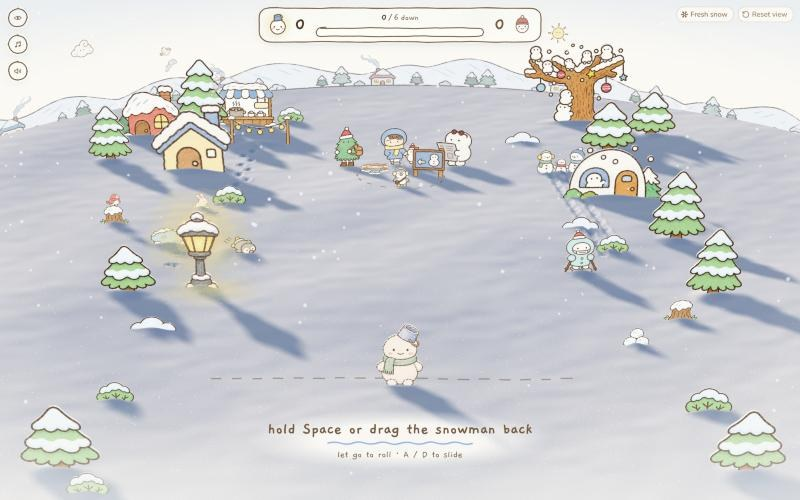

# Plop!


A cute, calm stress-relief toy: **paper bowling on snow.** A paper snowman stands at a line in a cosy village made
of Rachel's hand-drawn cut-outs. Pull back and the snowball at its feet rolls and grows; let go and it rolls through
a little crowd of paper friends and knocks them over. Plop!

Two snowmen (Bucket and Red Hat) take turns. One point per card down, a small bonus for a full clear. Nothing to
win, nothing to sign up for: it is about how it feels in the hand.

**Play it:** https://plop-two.vercel.app



## How to play

| | Move along the line | Pull back and aim | Throw |
|---|---|---|---|
| **Mouse / trackpad** | drag the snowman left or right | press on the snowman and drag back; sideways sets the angle | let go |
| **Touch** | same as mouse | same as mouse | let go |
| **Keyboard** | A / D or ← / → | hold Space (the pull grows while held); A / D or ← / → aim | release Space |

- **Escape** or the "Put it down" button cancels a pull (it does not count as a throw).
- **Look around:** drag on empty snow to turn and tilt, scroll or pinch to rise and pull back. "Reset view" returns
  to the throwing view.
- **Fresh snow** (button or **N**): new snow falls and smooths every groove away.
- The corner buttons switch the music and the sound effects on and off.

## Sharing in WeChat

The round paper-plane button at the bottom left shares the game: the system share sheet where the browser has one,
"link copied!" where it does not, and inside WeChat a little note pointing to the top-right **···** menu (WeChat does
not let a page open its share menu by itself).

**What works today (no account, no setup):**

- The link opens and plays inside WeChat's own browser on iPhone and Android: the 3D snow, dragging the snowman,
  sound after the first tap (iPhones only make sound after a tap anyway), and vibration on Android (iPhones have none).
- Sending the link from WeChat's ··· menu. The chat card uses what WeChat can read without an Official Account: the
  title "Plop!", the description, and a square picture of the snowmen (the first image on the page). WeChat versions
  differ: some show this picture and text, some show only the title and a plain link icon. That is WeChat's choice.
- Other apps (iMessage, Slack, X, Discord, Telegram…) show the full share card with the art.

**What a full rich WeChat card would need** (title, text and picture you choose, every time):

1. A domain of our own (`*.vercel.app` addresses are often slow or blocked in mainland China, and WeChat may warn
   before opening them).
2. ICP filing (备案) for that domain, which in practice means hosting it in mainland China, not only on Vercel.
3. A verified WeChat Official Account (认证公众号), with the domain added as its JS-SDK safe domain (JS接口安全域名).
4. A small server endpoint that signs the JS-SDK config with the account's secret, then `wx.updateAppMessageShareData`
   on the page. That adds a key to keep secret and code that runs on a server.

None of this was tested inside WeChat itself (it cannot be run here); it follows WeChat's known webview rules.

## Test pages (`/dev/*`)

Small pages for checking one part at a time. Not linked from the game and hidden from search engines.

| Page | What it shows |
|---|---|
| [`/dev/bowling`](https://plop-two.vercel.app/dev/bowling) | The throw alone on the snow: pull, aim line, roll (add `?fps` for the frame rate). |
| [`/dev/pins`](https://plop-two.vercel.app/dev/pins) | The paper cut-out pins with physics, chain reactions and the "N down!" count. |
| [`/dev/village`](https://plop-two.vercel.app/dev/village) | The whole scene without the score: throwing view, the village on the snow, the throw. |
| [`/dev/scenery`](https://plop-two.vercel.app/dev/scenery) | Every scenery cut-out on a sheet, plus the layout and camera previews. |
| [`/dev/scenery-3d`](https://plop-two.vercel.app/dev/scenery-3d) | Thick paper standees in 3D (`?view=default\|side\|high`, `?look=full\|flat\|billboard\|fixed`). |
| [`/dev/snowfall`](https://plop-two.vercel.app/dev/snowfall) | Press and mess up the snow, then try "Fresh snow". |
| [`/dev/hud`](https://plop-two.vercel.app/dev/hud) | The floating score panel and the music / sound switches with test buttons. |
| [`/dev/look`](https://plop-two.vercel.app/dev/look) | The real game with the paper finish (grain, soft edge) and before / after switches. |
| [`/dev/audio`](https://plop-two.vercel.app/dev/audio) | Every sound effect with a play button. |
| [`/dev/music`](https://plop-two.vercel.app/dev/music) | The background music player. |
| [`/dev/tokens`](https://plop-two.vercel.app/dev/tokens) | The design tokens: colours, fonts and corner radius. |

## Where things are

| Folder / file | What is in it |
|---|---|
| [`docs/SPEC.md`](docs/SPEC.md) | What Plop! is and why it looks the way it does. |
| [`docs/GAMEPLAY.md`](docs/GAMEPLAY.md) | How the game plays: the loop, the controls, scoring (source of truth for interaction). |
| [`docs/DECISIONS.md`](docs/DECISIONS.md) | Every decision so far, dated, so later work does not undo it. |
| [`docs/TUNING.md`](docs/TUNING.md) | The ten feel numbers that matter most and where they live. |
| [`docs/BLUEPRINT.md`](docs/BLUEPRINT.md) | The build map: what is done, what runs now, what waits. |
| [`docs/REVIEW.md`](docs/REVIEW.md) | A designer review of the whole game against the art. |
| [`docs/CREDITS.md`](docs/CREDITS.md) | Music and anything else made by other people, with licences. |
| `docs/reference/`, `art-source/` | Rachel's reference art: snowman turnarounds, scenery sheets, doodles. |
| `src/features/<name>/` | One folder per part of the game, each with its own README and `content.ts` of feel numbers. |
| `public/assets/` | The cut-out images and sounds, per feature. |
| [`CLAUDE.md`](CLAUDE.md) | Rules for coding sessions (look comes first, tokens only, one feature per folder). |

## Run it yourself

```bash
npm ci
npm run dev        # http://localhost:3000
npm run lint
npm run typecheck
npm run build
node scripts/smoke.mjs   # builds if needed, starts the server, checks every page loads
```

Built with Next.js, Tailwind, shadcn/ui and Three.js (React Three Fiber, drei, Rapier). Deployed on Vercel from
`main`; every pull request gets a preview link and runs CI (lint, typecheck, build, and the page smoke test).

## Credits

- **Art:** every character, prop and the village are Rachel's hand-drawn doodles and sheets (`art-source/`,
  `docs/reference/`), cut out into `public/assets/`.
- **Music and sounds:** see [`docs/CREDITS.md`](docs/CREDITS.md) for each file, its source and licence.
- **Fonts:** Gaegu and Nunito from Google Fonts (SIL Open Font License).
