# Plop! · designer review (#42)

A pass over the whole game on https://plop-two.vercel.app/ (main at `551bf43`, 2026-11-25), judged against
Rachel's art (`art-source/`, `docs/reference/`) and the "Look comes first" rule in `CLAUDE.md`.
Played in headless Chrome with the GPU on: desktop 1440×900 at 2× and phone 390×844 at 3×, throwing view,
a side view (drag across the snow), a high view and a low view, three full turns per size.
Screenshots are in `docs/review/`.

Camera choreography, lane length and throw power are left out on purpose: Rachel has raised them and the
throw-camera session is handling them.

**What already works and must not be lost:** the cut-outs are genuinely Rachel's drawings (crayon fill, warm
brown wobbly line, dot eyes), the paper-theatre backdrop is lovely, the token colours hold everywhere in the UI,
the hint and turn note are handwritten on a soft paper wash, and the throw feels snappy. Nothing looks like
plastic or "default 3D" except the places listed below.

## Part 1 · Ranked review (biggest impact first)

| # | Where | What is wrong (one sentence) | Proposed fix | Follow-up |
|---|---|---|---|---|
| 0 | Far hills (backdrop), throwing view behind the pins | The panorama breaks with a hard vertical gap and a white band where one copy of the hills ends and the next begins. | Cause and fix below the table. Being fixed by the throw-camera session while it moves the backdrop for the longer lane; not edited here. | throw-camera session |
| 1 | Snow, every view | Long, saturated blue-grey sun shadows are the darkest and largest shapes on screen, while Rachel's art has only short pale-blue strokes under things. | Raise the sun so shadows are about half as long and soften `shade.strength` so they read as pale `--snow-shadow` washes; snow stays real and lit. The paper edge (Part 3) eases it once wired in. | #45 |
| 2 | Phone portrait | No village in the frame, the lower 40% is plain grey snow, and the top stacks icons, pills and the score panel. | A few small cut-outs inside the narrow frame, the throwing view framed lower, the two pills moved into the icon column. The paper edge (Part 3) eases it once wired in. | #46 |
| 3 | The hit, the loop's best moment | A big ball stops in the middle of the formation and covers the fallen cards for 2 to 3 seconds before "N down!" appears. | Let the ball roll through and out (or burst on a card when big), and pop "N down!" as soon as the count is certain. | #47 |
| 4 | Pins | A card that falls flat becomes a thin sliver from the throwing view, so you barely see what you knocked down. | Land face-up more often, rest slightly tilted on a little heap, optional "x x" face decal. | #48 |
| 5 | UI chrome, top right | "Fresh snow" and "Reset view" are stock shadcn pills with Lucide icons, the only default-web-UI left. | Reuse the HUD's hand-drawn round icon style and put them in the left column. | #49 |
| 6 | Score bar, phone | The flying "+1" lands on the "N / 6 down" label so both are unreadable for a moment. | Land it at the bar's fill end; no panel redesign (that is #31, Rachel's design). | #50 |
| 7 | High view | The fine snow ends in a visible circle with a grainy, lighter ring around it. | Blend the fine tiles into the far snow over a wider band. | #51 |
| 8 | Pulling | The full ball rolls toward the camera and hides the snowman's face at the most tense moment. | Keep the ball beside the thrower's feet from the camera's side, or fade it a touch over the face. | #52 |
| 9 | Low view | The paper hills meet the snow in a hard light line. | Sink the backdrop's lower edge into real snow like the village bases. | #51 |
| 10 | Whole picture | The lit snow is smooth and photographic next to the crayon-paper tooth of the cut-outs, so the two read as two different media. | **Built here:** a faint `--ink` paper grain (Part 3; on `/dev/look`, home page after the throw-camera PR). | – |

### Item 0 · the backdrop seam, and why

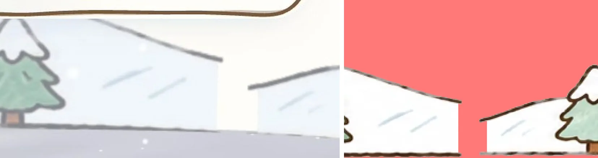

Cause (`src/features/scenery/three/Backdrop.tsx`, "Far hills band"): the hills are one curved band whose texture
is the panorama `public/assets/scenery/far-hills.webp` (2126×150 px) repeated with `RepeatWrapping`, about 2.7
copies along the 220° arc (`repeats = hillsRadius · arc / copyWidth`). The file is not drawn to tile:

- both ends are transparent margins, columns 0–8 on the left and 2119–2125 on the right, so every joint has a
  gap of about 16 px of the file (about 0.1 unit on the wall) where the pale paper sky wall shows through as a
  white band;
- the hill outline does not meet: it ends at row 95 on the right edge and starts at row 113 on the left, an
  18 px step out of 150, and both ends are cut straight down through the white fill with no outline, so the
  joint reads as a hard vertical edge.

With 2.72 copies the joints fall about 29° and 52° either side of straight back, so the 29° one sits just behind
the pins in the throwing view (clearest on a phone, where the backdrop comes closer). The repeat count is also
fractional, so the arc ends partway into a copy.

Fix (any one works; the first two are best): (a) a version of the panorama drawn to tile, with its ends meeting
at the same height and no transparent margin (art from Rachel or the image model); (b) mirror every other copy
(`MirroredRepeatWrapping` after trimming the transparent columns), so each joint meets its own mirror image at
the same height; (c) place whole copies only, with a short cross-fade or a tree / house cut-out standing over
each joint. Also round `repeats` to a whole number so the band never ends mid-copy.

### Screenshots

1. Shadows next to the art (left: game, right: `art-source/scenery/doodle-6-*`)
   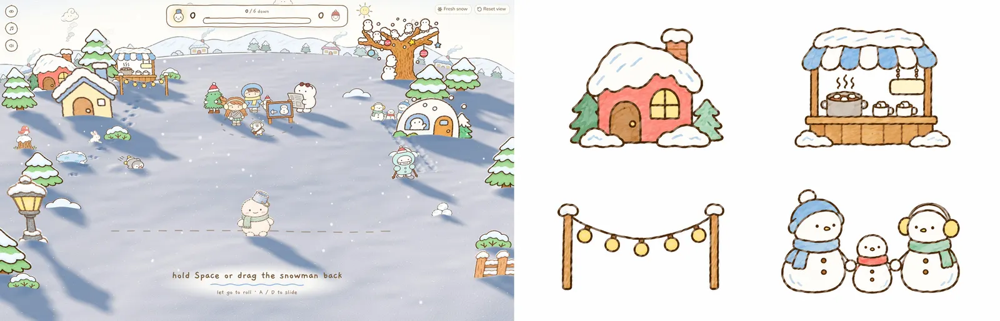
2. Phone: empty lower half, crowded top (start and after a throw)
   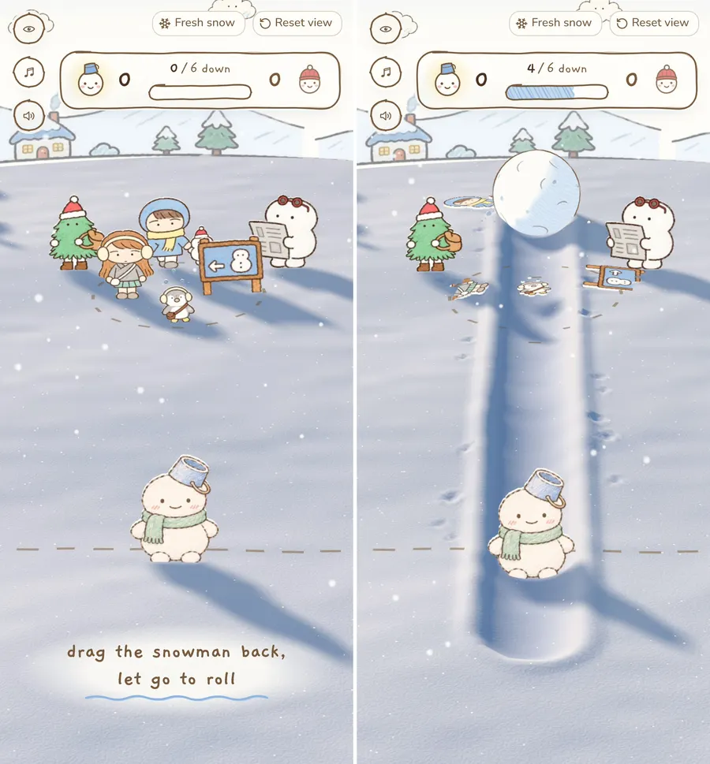
3. The ball parks on the pins (desktop, phone)
   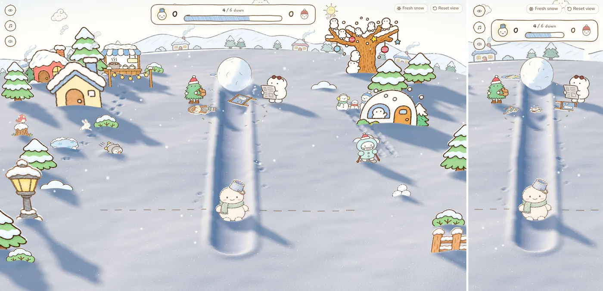
4. Fallen cards almost vanish
   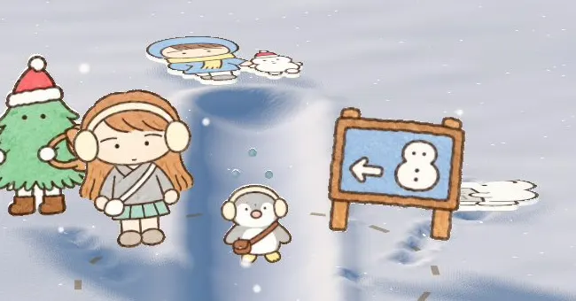
5. Default buttons
   
6. "+1" over the label on a phone
   
7. High view: the edge of the snow disc
   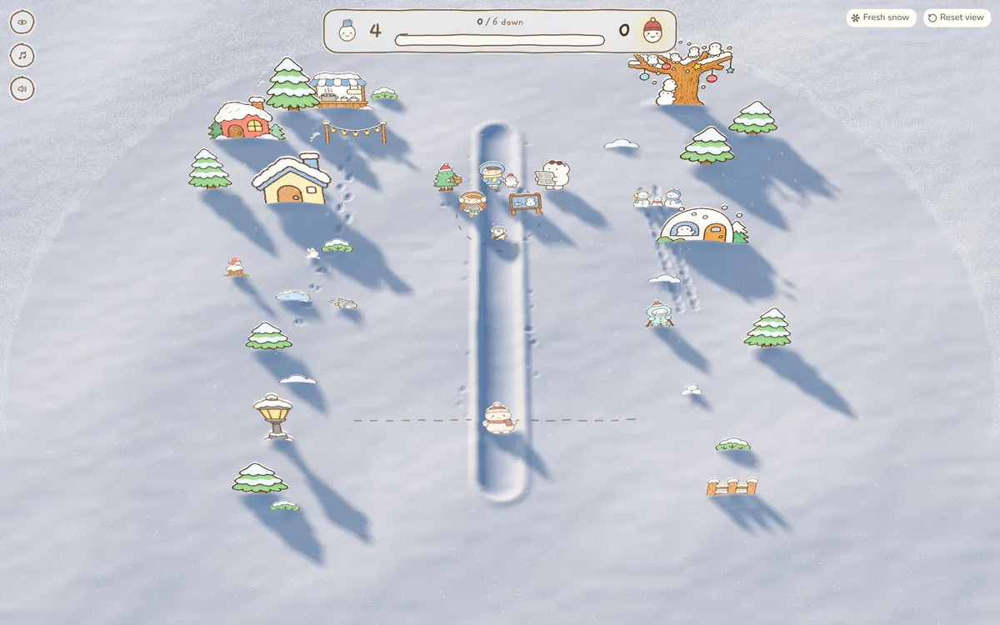
8. Pulling: the ball covers the thrower
   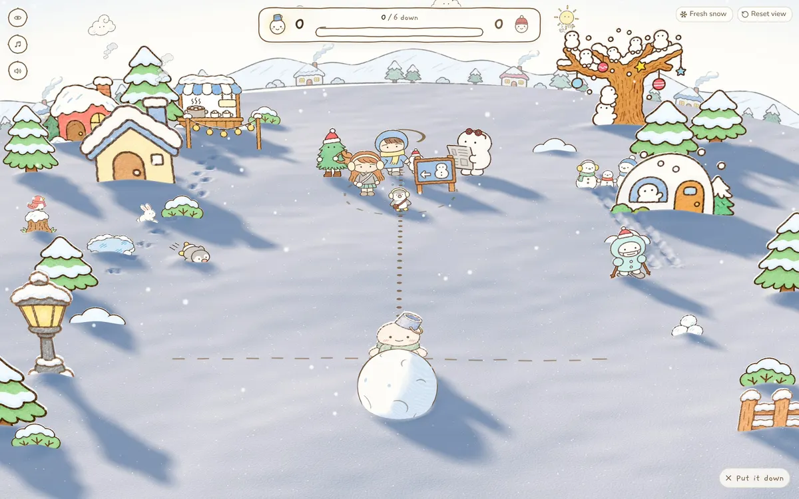
9. Low view: seam under the backdrop
   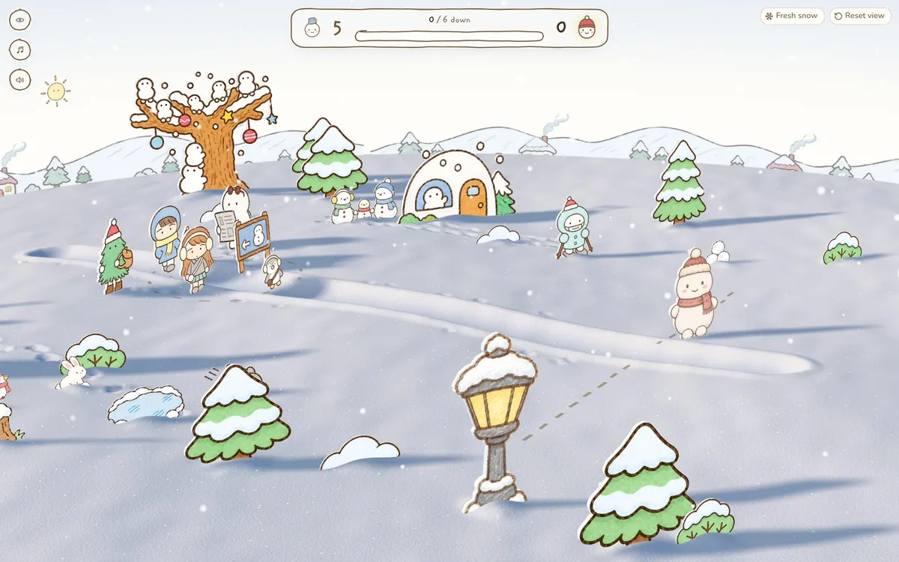
10. Side view (for reference: reads well, cut-outs face the camera, groove is lovely)
    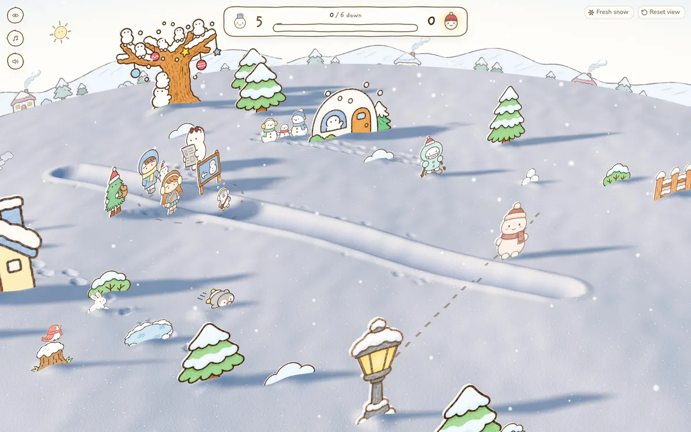

Moments that feel flat, in order: the wait between the hit and "N down!" (#3), the pull at full size when the
face disappears (#8), and the turn hand-over, which is fine but only a text note (left as is).

## Part 2 · Library picks

The key fact for every screen effect: the game draws the snow tone-mapped and the paper cut-outs not
(`toneMapped: false`, DECISIONS 2026-11-25). Three.js only tone-maps when drawing straight to the screen
(`three.module.js`, `if ( _currentRenderTarget === null … ) toneMapping = _this.toneMapping`). Any
`EffectComposer` draws into a render target first, so either the snow loses its tone mapping or a final
tone-mapping pass greys the paper. That breaks the "cut-outs stay exactly as now, snow stays real" rule.

| Candidate | What it would fix | Cost on a phone | Reduced-motion fallback | Verdict |
|---|---|---|---|---|
| `@react-three/postprocessing` tilt-shift | "Tiny diorama" reading | Full-screen blur pass at up to 3× pixel ratio; plus the composer's extra render target | Static, none needed | **No.** Blurred pencil lines look photographic, not drawn; and the composer breaks the tone-mapping split above. |
| … bloom on lamp and fairy lights | Warm glow | One more mip-chain pass | Static | **No.** The lights are unlit paper; a glow makes them glossy, and same composer problem. |
| … paper grain (Noise) | Item 10 | One pass | Static | **Yes, but without the library:** a CSS layer does it for free (below). |
| … vignette | Items 1 and 2 | One pass | Static | **Yes, but without the library, and toward `--paper` not dark:** a dark vignette is a photo trick; Rachel's sheets fade to white paper. |
| drei `Sparkles` | Magic in the air | Cheap points | Turn off | **No.** There is already real falling snow; glitter reads as digital. |
| drei `Clouds` | Sky | Many overdraw sprites | Freeze | **No.** Volumetric clouds are the definition of default 3D; the sky is Rachel's paper backdrop. |
| drei `ContactShadows` | Grounding | Extra depth render each frame | n/a | **No.** Cut-outs already sit in real snow heaps with real shadows; item 1 wants fewer, not more, shadows. |
| drei `SoftShadows` (PCSS) | Softer shadow edges | Heavy: many shadow-map taps per pixel on the whole snow | n/a | **No.** The shadow edges are already soft; the problem is length and darkness (#45). |
| Motion (`motion`) | UI springs | About 30–40 kB of script | Its own reduced-motion switch | **No.** The turn note, "N down!" and the score bar already spring with CSS (overshoot curves and keyframes, with reduce-motion fades). Nothing in the review needs it. |

**Result: no new library.** The two picks are plain CSS, inside a new `src/features/look/`.

## Part 3 · Built, on `/dev/look` (home page wiring waits)

Both layers live in `src/features/look/` and are on `/dev/look` over the real game. They are **not on the home
page yet**: the throw-camera session owns `src/features/game/` right now, so the wiring waits for its PR to merge.
It is one import and one line in `src/features/game/Game.tsx`, right after `</SnowScene>` (under every piece of UI):

```tsx
import { PaperFinish } from "@/features/look";
// …
      </SnowScene>
      <PaperFinish />
```

They never touch the 3D render, so the cut-outs are exactly as before and the snow
is the same lit snow underneath. Switch them on `/dev/look` (or `?grain=0` / `?edge=0`). Numbers in
`src/features/look/content.ts`. Neither moves, so "reduce motion" needs nothing.

1. **Paper grain** (commit "Look: faint paper grain…"): a still crayon-paper tooth in `--ink` at 6.5% through a
   fractal-noise mask. It gives the smooth snow and the blue shadows the same paper tooth as the cut-outs.
   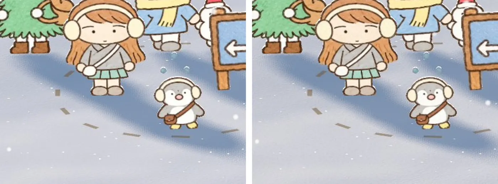
2. **Paper edge** (commit "Look: soft paper edge…"): the picture fades into `--paper` at the bottom (50%) and in
   the corners (45%), like a drawing that stops before the sheet's edge. It calms the heaviest foreground shadows
   and the empty bottom of the phone view; the lane and pins in the middle are untouched.
   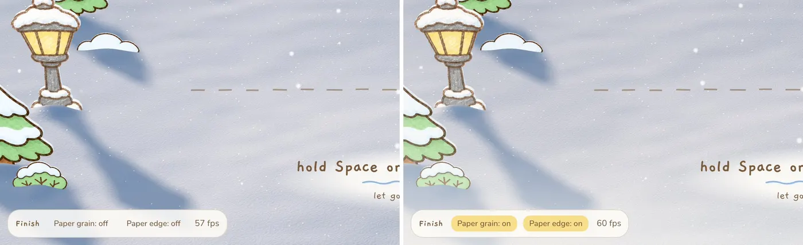

Before / after, whole screen (left before, right after):

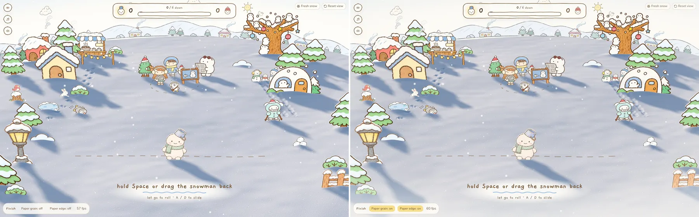
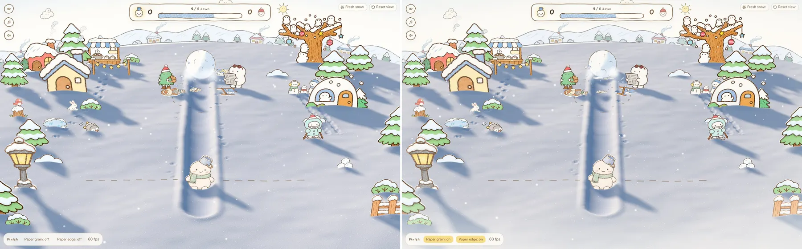
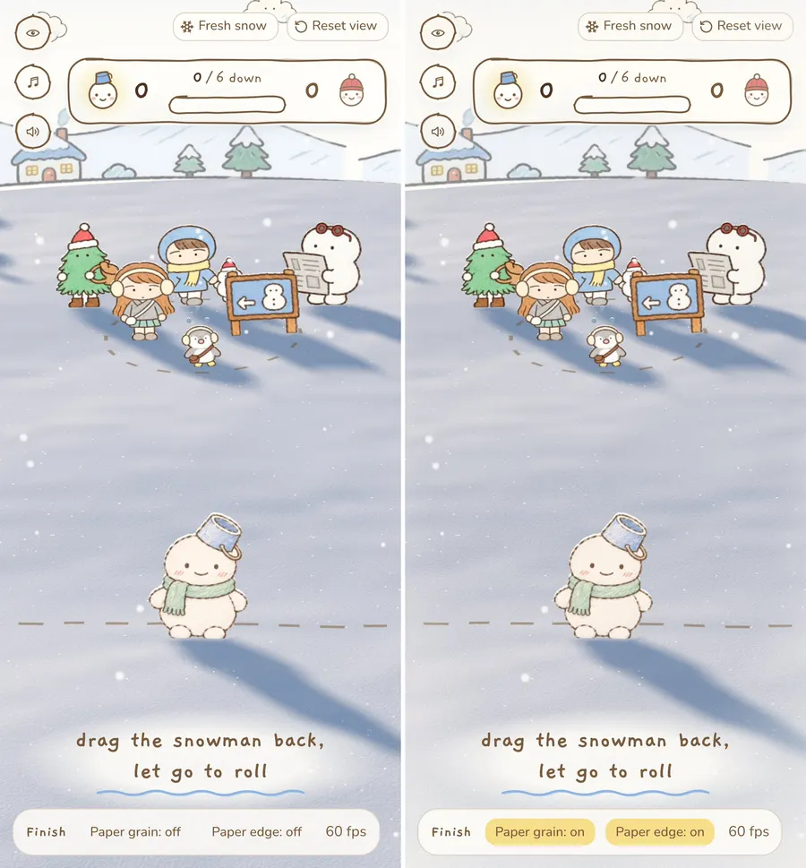

Next to Rachel's art (left: game with both layers, right: `art-source/scenery/sheet-4-friends.png`):

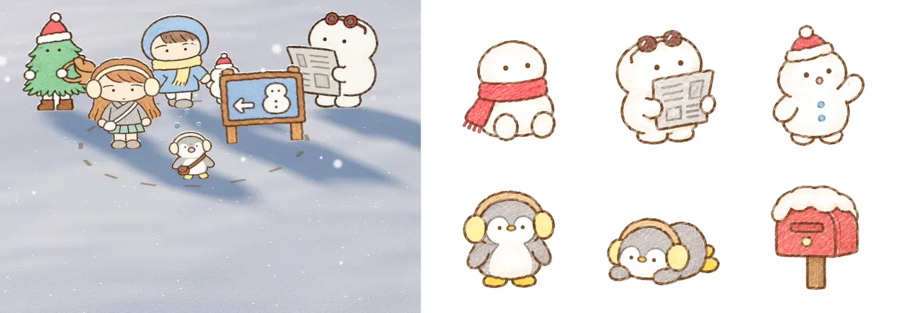

### Frame rate (headless Chrome, GPU on, production build, `/dev/look`)

| Size | Layers | Idle fps · p95 frame | Rolling fps · p95 frame |
|---|---|---|---|
| Desktop 1440×900 @2× | off | 59 · 16.7 ms | 60 · 16.7 ms |
| | grain | 60 · 16.8 ms | 60 · 16.7 ms |
| | edge | 60 · 16.7 ms | 61 · 16.7 ms |
| | both | 60 · 16.7 ms | 60 · 16.8 ms |
| Phone 390×844 @3× | off | 60 · 16.8 ms | 60 · 16.7 ms |
| | grain | 60 · 16.7 ms | 60 · 16.8 ms |
| | edge | 60 · 16.8 ms | 60 · 16.7 ms |
| | both | 60 · 16.8 ms | 60 · 16.8 ms |

No frame drops. The test machine is capped at 60 by vsync, so this shows "no cost", not headroom; the layers are
static and composited once, which is why they are free on a real phone too. Not yet checked on a real phone.

### Where it still falls short (honestly)

- Both layers are subtle by design. The grain is visible up close, not across the room; the edge does not fix the
  shadows (#45) or the empty phone view (#46), it only softens them.
- The paper edge also lightens the cut-outs that stand in the corners (the bush and tree at bottom left) by up to
  45%. It reads as "the drawing fades out", but it is a change to how those cut-outs look; `LOOK.edge.corner` is the
  knob, and 0 keeps only the bottom fade.
- The "Fresh snow" / "Reset view" pills sit inside the snow scene, so they get the grain too (barely visible).
- On `/dev/look` the finish sits over the whole game, so the hint and "N down!" get it too; on the home page it goes under them.
- The before / after screenshots were taken with the layers wired into the game (under all UI), as they will be once wired.
- The biggest wins in this review (items 1 to 4) belong to other features and are in follow-up issues #45 to #52.
